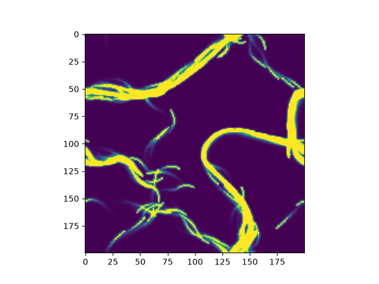

# Devlog

Working notes, newest entries first. The overall plan is in [design-notes.md](design-notes.md).

---

## 2026-11-19: Added agents class and tested it's new parameters

**Goal:** Create agents class that deposits pheromones and follows trails.

**Done:**
- `Agents` created in `agents.py`. It stores agent positions and headings on sub-index values, and can move them. They can place a pheromone on the grid, and sense the grids pheromones to decide their next heading.
- `AgentParams` in `params.py` to store parameters that can be live updated.
- Edited existing tests that were written before agents existed, and new tests for agents. This was done by Claude.

**Next:**
- Make the params loadable from a file.
- Find a way to live update the params while the simulation is running.
- See about adding multiple species of mold that interact differently and have differen colors.
- Output function to save a image or gif to disk, with a parameter sidecar (which includes frame nr(s)!)

**Note:**
An example of what it looks like now!


```
height, width = 200, 200
decay_rate, diffusion_rate = 0.875, 0.075
count = 400
step_size, deposit_amount = 1, 1
sensor_distance, sensor_angle = 10, 1
turn_speed = 0.07
seed = 1
```

**Commits:** `dbb84a6` Added agents to the simulation

## 2026-11-18: Create prototype in numpy and move it into modules

**Goal:** Create a prototype of the world grid and experiment with how it can be displayed in matplotlib

**Done:**
- Created a prototype script with classes for the trailmap and simulation, a function to run them, and dataclasses for parameters.
- Added documentation for them.
- Moved to separate modules in src and deleted script.
- Let Claude write the tests for simulation and trailmap.

**Decisions:**
- The separation of responsibilities in the classes to keep simplicity.

**Next:**
- Create agents class that will deposit pheromones and follow trails.

**Commits:**
- `8f9408f` Prototype of creating, running and displaying the map that the agents will later live in.
- `a95ad7f` Moved prototype script into modules


## 2026-11-17: Repo scaffolding and plan for the first step

**Goal:** Set up the repo and make a numpy prototype.

**Done:**
- Created repo with `uv init --package --vcs git --python 3.12 --description "Physarum slime-mold simulation on the GPU" physarum`
- Added numpy, scipy and matplotlib, and pytest and ruff as devtools
- Setup the repo with README, CLAUDE, AI-USE and LICENSE.
- Placed an idea note that was written from a chat with Claude: [design-notes.md](design-notes.md).
- Setup placeholder test.

**Decisions:**
- **Python 3.12, not newer:** Taichi that will be used later does not reliably support newer versions.
- **Matplotlib for displaying:** `imshow` to open a window and then update it with `set_data` each frame. Speedier solutions for later.

**Next:**
- Step 1 would be to build a prototype in python of how the world is gonna behave. See if the diffuse and decay work well.

**Commits:** `598f803` Initial project scaffold